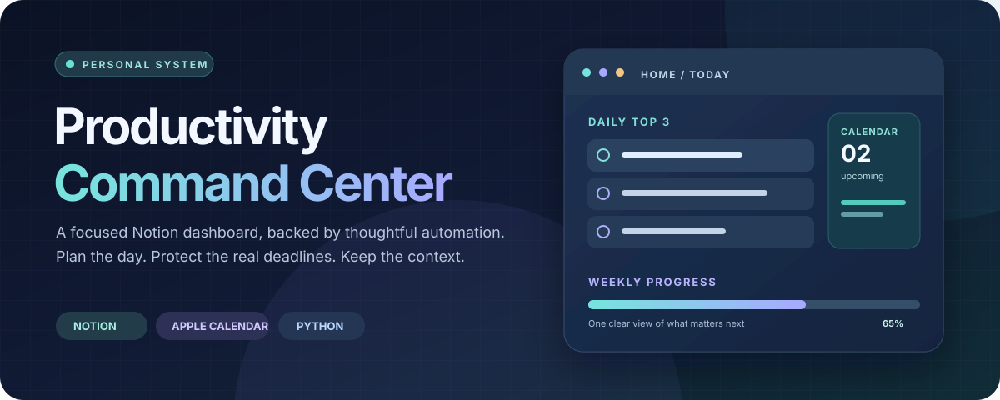
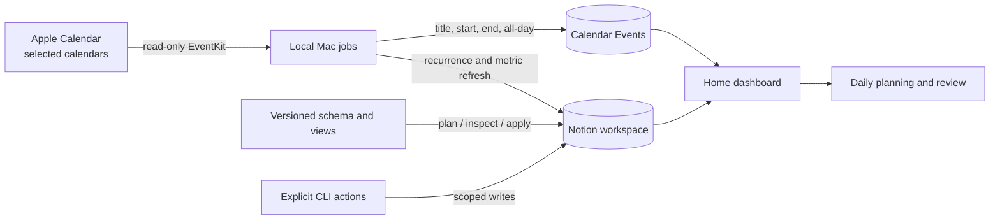

<div align="center">
  

  <p><strong>A personal operating system in Notion, with a small, inspectable Python and macOS integration layer.</strong></p>

  <p>
    <a href="https://github.com/Vishesh1305/notion-productivity-command-center/actions/workflows/ci.yml"></a>
    
    
    
  </p>

  <p><a href="#the-system">Explore the system</a> · <a href="#quick-start">Quick start</a> · <a href="#architecture">Architecture</a> · <a href="#safety-and-privacy">Safety</a> · <a href="STATUS.md">Current status</a></p>
</div>

---

## What this is

Productivity Command Center combines a **dashboard-style Notion workspace** with deterministic local tooling. Notion holds the human-facing records. This repository describes the databases and views, provides repeatable setup and recovery commands, and runs three optional Mac jobs: a read-only Apple Calendar mirror, managed recurrence generation, and weekly plan metric refresh.

The design keeps a clear boundary between **planning**, **real deadlines**, and **appointments**. It is intentionally a personal template and implementation reference, rather than a hosted service or a one-click Notion import. Native Notion buttons, automations, templates, and a few exact rolling view filters require finishing in the Notion interface. See [current status](STATUS.md) for what has been verified and what still needs a live check.

### At a glance

| Surface | What it does |
| --- | --- |
| **Home** | Daily Top 3, upcoming appointments, weekly priorities, Inbox, active projects, and plan follow-through in one place. |
| **Tasks** | Separates due dates, plan dates, and optional time blocks; tracks Waiting, Done, Cancelled, and managed recurring work. |
| **Projects & Goals** | Connects work to Areas and evidence, with child Projects representing phases. |
| **Capture Queue & Notes** | Keeps raw ideas intact before triage; stores durable notes separately. |
| **Habits & Reviews** | Tracks cadence, check-ins, pauses, and daily, weekly, and monthly planning logs. |
| **Calendar Events** | A private title-and-time display cache of explicitly selected Apple calendars, with freshness status. |

## The system

The declarative contract currently defines **10 databases**, **8 navigation pages**, **21 saved database views**, and a six-section Home. It includes scoped, additive reconciliation so repeated setup can discover existing objects rather than create duplicates.

| Database | Purpose | Important links |
| --- | --- | --- |
| Tasks | Work, lifecycle, priority, dates, blockers, recurrence | Project, Area, parent Task, series |
| Projects | Outcomes and child phases | Area, Goal, parent Project |
| Goals | Evidence-led long-term outcomes | Area |
| Areas | Stable life taxonomy | Projects, Goals, Notes |
| Notes | Durable writing and references | Area, Goal, Project, source capture |
| Capture Queue | Unprocessed thoughts and requests | Notes after triage |
| Habits | Cadence definitions and versions | Area, replacement Habit |
| Habit Check-ins | Done, Excused, and pause events | Habit |
| Planning Log | Confirmed daily and weekly choices; monthly reviews | Tasks, related week |
| Calendar Events | Read-only appointment mirror and sync health | Selected Apple calendars |

The exact properties, formulas, relation targets, and base view filters live in [`definitions.py`](src/command_center/definitions.py). The [schema guide](specifications/schema-and-views.md) explains how they fit together.

### A few deliberate rules

- **Due date** means a real deadline; **Plan date** means intended work day; **Time block** is a proposed schedule slot. One never silently changes another.
- A calendar sync **reads Apple Calendar** and writes only managed rows in Notion. It does not edit appointments, copy invitation details, or create Tasks from events.
- A daily Top 3 or weekly priority becomes adopted only after confirmation. Review drafts and final decisions stay separate.
- Notion page IDs, selected calendar IDs, exports, and credentials are local configuration, not source code.
- `America/Vancouver` defines day boundaries. Timed mirrored events are written with the local UTC offset so Notion's date picker opens at the expected local time.

## Architecture



The Python package in `src/command_center/` contains the Notion client, schema reconciliation, domain rules, and record actions. `macos/` contains a small Objective-C EventKit exporter plus LaunchAgent wrappers. The exporter is read-only; the Notion client applies bounded requests and re-reads ambiguous writes before any retry.

## Quick start

### 1. Run the offline checks

Python **3.11+** is required. A Mac is required only for the Apple Calendar bridge and background jobs.

```bash
git clone git@github.com:Vishesh1305/notion-productivity-command-center.git
cd notion-productivity-command-center
python3 -m venv .venv
source .venv/bin/activate
python -m pip install -e .
python -m unittest discover -s tests -q
command-center plan
```

`plan` makes no network request. It shows the intended structure before connecting any account.

### 2. Point at a private Notion parent page

```bash
cp manifest.example.json manifest.json
```

Edit the ignored `manifest.json` with the parent page ID and, later, the calendar IDs you explicitly choose. Create a Notion internal connection with content read, insert, and update permissions; grant it access only to the intended private parent. Keep the token in your environment or macOS Keychain. Then run the read-only inspection before applying any structural changes:

Load `NOTION_API_KEY` from your secret manager into the process environment without typing the token into shell history, then run:

```bash
command-center inspect
command-center apply
command-center inspect
```

Do not save a real token in this repository or a public issue. For the exact setup sequence, Notion UI steps, and recovery behavior, use [Setup and recovery](docs/SETUP.md).

### 3. Add the optional Mac calendar mirror

```bash
command-center calendars
```

Grant the compiled `CalendarExport` helper macOS Calendar access when prompted. Choose calendar IDs deliberately and place them in ignored `manifest.json`. Store the Notion token in Keychain and run a one-shot check before installing background jobs:

```bash
macos/store-notion-token.sh
macos/run-job.sh sync-calendar
macos/run-job.sh generate-recurrence
macos/run-job.sh refresh-metric
macos/install-jobs.sh
```

The installer generates user LaunchAgents from the checked-in examples using the current checkout path. The jobs run calendar sync about every **15 minutes**, recurrence generation daily, and metric refresh hourly while the Mac is available. Calendar access is read-only; the mirror can become stale when the Mac is asleep or offline. Home exposes freshness and links to live Notion Calendar for that case.

## Command map

| Command | Purpose | Writes? |
| --- | --- | --- |
| `plan` / `plan --json` | Preview the declared structure without network access | No |
| `inspect` | Compare the selected Notion workspace with the declaration | No |
| `apply` | Add missing supported structure after inspection | Yes |
| `seed` | Create the approved starter Areas and example chain once | Yes |
| `calendars` | List local Apple calendars for explicit selection | No |
| `sync-calendar` | Mirror the selected window into private Calendar Events | Notion only |
| `generate-recurrence` | Create forward managed Task occurrences | Yes |
| `capture`, `done`, `cancel`, `waiting` | Record explicit everyday actions | Yes |
| `confirm-day`, `confirm-week`, `draft-review` | Record accepted planning and review choices | Yes |
| `habit-checkin`, `habit-report` | Record or inspect Habit progress | Check-in only |
| `refresh-metric` | Recompute confirmed Top 3 follow-through | Yes |

Use `command-center --help` for argument forms. All live commands act on the workspace selected by `manifest.json`; `inspect` is the safest first command on an existing workspace.

## Safety and privacy

This is a **public code repository**, not a public Notion workspace. Keep the Notion parent and Calendar Events database private. The repository's [`.gitignore`](.gitignore) excludes local manifests, exports, builds, calendar payloads, logs, virtual environments, and common credential files. The published history begins with a sanitized snapshot; private workspace URLs and earlier local operational history are deliberately absent.

- Never commit `manifest.json`, API tokens, appointment exports, or a real calendar feed URL.
- Before an additive change to populated data, the setup code exports a local snapshot into ignored `exports/`.
- Failed or partial Apple Calendar reads do not inactivate previously mirrored events or advance sync health.
- The mirror carries appointment title, start/end, all-day state, and internal sync metadata only. It omits descriptions, attendees, location, and invite links.
- Native Notion permissions still apply. Limit the internal connection to the intended private page and review scopes before connecting another AI client.

The [AI behavior guide](docs/AI-BEHAVIOR.md) describes when automated edits are routine and when a human should confirm choices. [Setup and recovery](docs/SETUP.md) documents partial failures and repair steps.

## Repository map

```text
.
├── src/command_center/   # Schema, Notion API client, rules, CLI, sync logic
├── macos/                # Read-only EventKit helper and LaunchAgent templates
├── tests/                # Offline domain and reconciliation checks
├── specifications/       # Versioned product and data-model decisions
├── docs/                 # Setup, behavior guide, references, status history
├── manifest.example.json # Public configuration shape; copy locally
└── STATUS.md             # Verified implementation state and open checks
```

## Status and scope

The core schema, local actions, private dashboard, Mac jobs, and live calendar mirroring have been exercised. **Some acceptance checks remain open**, including a separate Claude write-route check, a real phone/light-mode review, and metrics against an actual confirmed plan. See [STATUS.md](STATUS.md) for the current list. This repository does not include the user's live Notion data or a distributable template file.

No license has been added. The source is visible, but reuse rights have not been granted by a license.
